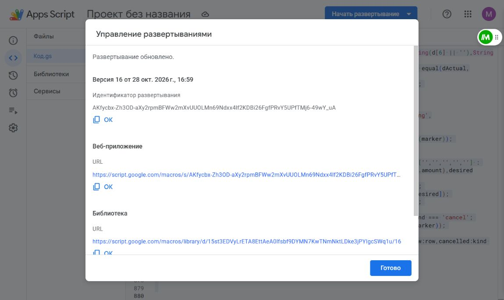

# Showroom vehicle sales release — 2026-10-28

## Published
- PR #43 merged as 68666c145ed5fd9354970cf7a4020112a52b3b42.
- Existing Apps Script deployment updated through browser from v15 to v16, unchanged /exec URL and permissions.
- Exact deployed source: FinanceBridgeLive_2026-10-28.gs. Only capability flag and allowed vehicle articles differ from live v15; SHA256 regression enforces this. QA helpers removed before publishing and editor reread exactly.
- Authenticated published get_context: ok=true; showroom_vehicle_sale_subcategory_supported=true; purchase, driver wallet and correction flags retained.
- Supabase vlcxjizieelcfunausll / fleetdesk-telegram-finance v22 ACTIVE. Published source reread exactly; verify_jwt=false retained. Health: telegram_ready=true, finance_bridge_ready=true.
- Vercel production dpl_FpR6VKHVoX1qtaNYQo2KdwW7TouL READY from merge commit; uae-drive-suite.vercel.app alias verified. Browser opens Telegram entry route without console errors; outside Telegram it correctly requires opening through bot.

## Real Google Sheets QA
QA workbook: 1B2JraDVMC4Ps3j_seaEsVQiTZvS3u13iiN3No3qUa6Q, copied from production.
12 category/car combinations written through exact candidate recordEntry_ functions with QA showroom ID and disabled Rental ID:
- 6 purchases at journal rows 88–93
- 4 investor sales at rows 94–97
- 2 own sales at rows 98–99
All T values match exact canonical names.
All 12 Month report deltas checked individually: purchase rows 135–140; investor sale rows 109–112; own sale rows 106–107. Every delta equals its test amount.
Own-sale same-ID retry returned duplicate; different ID/same payment rejected.
The first comprehensive run reached Apps Script's six-minute execution limit after 10 cases; remaining own sales and duplicate checks completed in a short runner. Timeout was not treated as PASS.

## Financial preservation
Production journal A5:T1004, Month A1:J346 and driver ledger A1:I1000 reread after publication and exactly equal the initial snapshots.
Cash balance 6924.50 AED; AJMAN -17382 AED; combined -10457.50 AED unchanged.
Original production rows also exactly match the QA copy originals. Drivers unchanged.
Historical 2400 AED sale remains unallocated in Month row 113. No production test payment created.
Rental code is byte-preserved by the source regression; no live Rental writes or deployment changes outside this shared Bridge.

## Local checks
- Build PASS.
- TelegramFinanceApp behavioral tests: exact per-article car lists, all car choices, required selection, review and separate vehicle payload: 3 PASS.
- Existing FinanceCorrection UI tests: 5 PASS.
- Edge real handler validation: 21 assertions PASS covering all 12 pairs, unknown/missing vehicle, wrong note and missing rollout capability; no network or database writes.
- Existing correction handlers: 38 assertions PASS.
- Catalogue, purchase/T/retry and live-candidate regression tests PASS.
- ESLint: zero errors; one existing effect dependency warning.

## Remaining verification limitation
Real Telegram session verification is BLOCKED: connected browser displays Telegram QR sign-in. No signed initData was forged and no production payment submitted.
Local UI behavior and real QA accounting passed; do not claim the vehicle selector was personally verified inside an authenticated live Telegram session.
To close: sign in at the retained Telegram browser tab, open the bot Mini App, choose each of the three categories and inspect/select each expected car without submitting a production payment.

